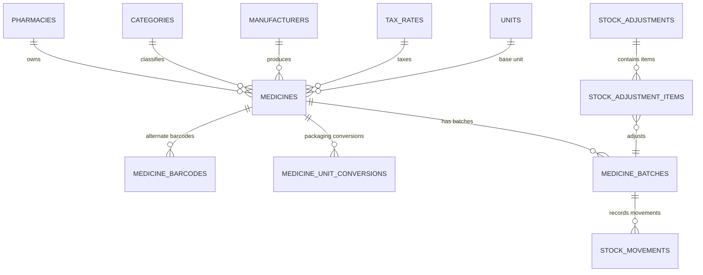

# Pharmacy ERP — Phase 2: Medicine Catalogue & Inventory Completion Report

**Project:** Indian Retail Pharmacy ERP  
**Phase Completed:** Phase 2 (Medicine Catalogue, Packaging Unit Conversions, Batch & Expiry Management, Inventory Ledger & Adjustments, GST Tax Masters)  
**Verification Date:** October 20, 2026  
**Status:** **APPROVED & FULLY VERIFIED**  

---

## 1. Executive Summary

Phase 2 builds upon the verified Phase 1 authentication, RBAC, and system settings foundation by introducing the core pharmaceutical catalogue and inventory management engine. All business rules are enforced strictly in the **FastAPI** backend with database transactions and row-level locking (`with_for_update()`), ensuring absolute data integrity, auditability, and statutory compliance under the **Drugs and Cosmetics Act, 1940**, **Drug Price Control Orders (DPCO)**, and the **Goods and Services Tax (GST) Act**.

All 77 automated backend tests across Phase 1 and Phase 2 passed without failure both in local SQLite test isolation and inside the live Docker deployment container against MySQL 8.4 LTS InnoDB. The Next.js 15 + TypeScript frontend compiles cleanly with 0 type errors and production static generation succeeds for all routes.

---

## 2. Database Schema & Alembic Migration

### Alembic Migration Revision: `002_20261020_phase2_inventory_schema.py`
- **Revision ID:** `002` (Parent: `001`)
- **Target Engine:** MySQL 8.4 LTS InnoDB (with cross-dialect compatibility for SQLite test suite via `PK_BIGINT` / `FK_BIGINT`)
- **Tables Introduced:** 11 normalized tables



### Table Specifications:
1. **`tax_rates`**: Configurable GST slabs (0%, 5%, 12%, 18%, 28%, Exempt) with explicit CGST, SGST, IGST, and CESS percentages.
2. **`categories`**: Therapeutic classifications (e.g., Antibiotics, Analgesics, Cardiac, Antidiabetic, Gastrointestinal).
3. **`manufacturers`**: Pharmaceutical companies and marketing entities with short codes and contact details.
4. **`units`**: Measurement units with statutory `is_fractional_allowed` flag (preventing illegal fractioning of indivisible solid dosage forms such as tablets/capsules).
5. **`medicines`**: Core catalogue formulations holding brand name, generic formulation, strength, dosage form, HSN code, drug schedule (`schedule_type`: NONE, H, H1, X, G, NARCOTIC, OTC), prescription mandate (`requires_prescription`), reorder thresholds, and base unit pointer.
6. **`medicine_barcodes`**: Alternate/multi-pack barcodes (EAN-13, GS1, or custom SKU) mapped to specific packaging units with uniqueness constraint per pharmacy.
7. **`medicine_unit_conversions`**: Medicine-specific packaging unit conversions (e.g. 1 Strip = 10 Tablets, 1 Box = 10 Strips) with `DECIMAL(12, 4)` conversion factors and purchase/sales flags.
8. **`medicine_batches`**: Batch records with manufacturing date, mandatory expiry date, MRP snapshot, purchase rate, derived cost per base unit, default selling rate (guaranteed $\le$ MRP), rack/shelf location, and current stock balance in base units.
9. **`stock_movements`**: Immutable chronological stock ledger capturing every inflow/outflow (`OPENING_STOCK`, `GOODS_RECEIPT`, `ADJUSTMENT_IN`, `ADJUSTMENT_OUT`, `SALE_DISPENSE`, `RETURN_INWARD`). Every entry snapshots the `balance_after_base`, unit cost, total cost, reference ID, and audit user.
10. **`stock_adjustments`**: Stock audit vouchers with reason codes (`DAMAGE_BREAKAGE`, `EXPIRY`, `THEFT`, `AUDIT_DISCREPANCY`, `PHYSICAL_AUDIT_SURPLUS`, `CORRECTION`).
11. **`stock_adjustment_items`**: Line items for adjustment vouchers comparing book system stock vs. verified physical count.

---

## 3. Backend Business Services

### 3.1 Pure Decimal GST Tax Calculation Service (`backend/app/services/tax.py`)
- Computes GST for both **tax-inclusive** (retail MRP mode) and **tax-exclusive** (wholesale/B2B mode) transactions.
- Pure `Decimal` arithmetic with `ROUND_HALF_UP` rounding at 2 decimal places to prevent floating point drift.
- Automates intra-state split (50% CGST + 50% SGST) vs. inter-state supply (100% IGST).
- Prepares immutable tax snapshots for future Phase 3 POS sales and purchase billing.

### 3.2 Packaging Unit Conversions & Free Goods Costing (`backend/app/services/units.py`)
- Standardizes all internal accounting to each medicine's defined base dispensing unit.
- Validates fractional restrictions: prevents fractional quantities if `base_unit.is_fractional_allowed` is `False`.
- Prevents ambiguous conversion cycles and self-referencing packaging units.
- Implements **allocated acquisition costing** for supplier free quantities (e.g., "Buy 10, Get 2 Free"): spreads invoice line total cost across 12 units, reducing per-unit cost rather than booking zero-cost inventory.

### 3.3 Inventory Ledger & Row-Locked Adjustments (`backend/app/services/inventory.py`)
- **Row-Level Locking**: Physical stock adjustments invoke `select(MedicineBatch).with_for_update()` to prevent race conditions during concurrent stock modifications.
- **Atomic Commits**: Balance updates and corresponding ledger movements commit or roll back together.
- **Batch Deletion Protection**: Prevents deletion of any batch with historical ledger movements (`409 Conflict`).
- **Statutory Expiry Controls**: Computes `is_expired` dynamically; blocks expired batches from active dispensing workflows.
- **Stock Surveillance**: High-performance alert queries for low-stock items ($\le \text{reorder\_level}$), near-expiry items within configurable days (30/60/90/180), and expired batches requiring immediate quarantine.

---

## 4. REST API Endpoints Implemented

| Method | Endpoint | Description | Auth / Permission |
|---|---|---|---|
| `GET` | `/api/v1/tax-rates` | List active GST tax slabs | Authenticated |
| `POST` | `/api/v1/tax-rates` | Create new GST tax slab | `settings.manage` |
| `PUT` | `/api/v1/tax-rates/{id}` | Update GST tax slab | `settings.manage` |
| `POST` | `/api/v1/tax-rates/calculate` | Interactive GST calculation simulator | Authenticated |
| `GET` | `/api/v1/categories` | List therapeutic categories | Authenticated |
| `POST` | `/api/v1/categories` | Create medicine category | `medicines.manage` |
| `GET` | `/api/v1/manufacturers` | List pharmaceutical manufacturers | Authenticated |
| `POST` | `/api/v1/manufacturers` | Create manufacturer record | `medicines.manage` |
| `GET` | `/api/v1/units` | List units of measure | Authenticated |
| `POST` | `/api/v1/units` | Create unit with fractional flag | `medicines.manage` |
| `GET` | `/api/v1/medicines` | Search/filter medicines with pagination | `medicines.view` |
| `POST` | `/api/v1/medicines` | Create medicine formulation | `medicines.manage` |
| `GET` | `/api/v1/medicines/{id}` | Get medicine details & stock | `medicines.view` |
| `PUT` | `/api/v1/medicines/{id}` | Update medicine catalogue data | `medicines.manage` |
| `GET` | `/api/v1/medicines/lookup/barcode/{barcode}` | Quick scan barcode lookup | `medicines.view` |
| `GET/POST`| `/api/v1/medicines/{id}/barcodes` | Manage alternate packaging barcodes | `medicines.manage` |
| `GET/POST`| `/api/v1/medicines/{id}/conversions` | Manage packaging unit conversions | `medicines.manage` |
| `GET/POST`| `/api/v1/batches` | List batches & register new batch | `medicines.manage` |
| `PUT/DELETE`| `/api/v1/batches/{id}` | Update batch or delete empty batch | `medicines.manage` |
| `POST` | `/api/v1/inventory/opening-stock` | Record opening stock intake | `stock.adjust` |
| `POST` | `/api/v1/inventory/adjustments` | Post physical audit adjustment voucher | `stock.adjust` |
| `GET` | `/api/v1/inventory/movements` | Chronological immutable movement ledger | `stock.view` |
| `GET` | `/api/v1/inventory/alerts/low-stock` | Low-stock SKU alert report | `stock.view` |
| `GET` | `/api/v1/inventory/alerts/near-expiry` | Near-expiry surveillance report | `stock.view` |
| `GET` | `/api/v1/inventory/alerts/expired` | Quarantine expired batch report | `stock.view` |
| `GET` | `/api/v1/inventory/valuation` | Total stock valuation snapshot | `reports.view` |

---

## 5. Frontend Pages & User Interface

Built with Next.js 15, TypeScript, Tailwind CSS 4, Lucide React icons, and Framer Motion micro-animations:

1. **Shared Navigation (`frontend/components/Navbar.tsx`)**:
   - Sticky glassmorphism header with active route spring pill animation.
   - Live badge counters for total low-stock + expiry warnings.
   - Staff credentials and quick sign-out.
2. **Medicine Catalogue (`frontend/app/medicines/page.tsx`)**:
   - Comprehensive catalogue data table with schedule badges (Schedule H in amber, Schedule X in rose, OTC in emerald), prescription requirements, and live base unit stock.
   - Quick barcode scanner input with instant product lookup.
   - Full filtering by Search, Category, Schedule classification, Rx-only, and Low-stock only.
   - Interactive slide-over modal for creating new formulations.
   - Multi-tab management drawer for selected medicine: formulation details, alternate barcodes, packaging conversions, and batch inventory list.
3. **Inventory & Ledger (`frontend/app/inventory/page.tsx`)**:
   - Live financial valuation KPI cards: Total stock cost valuation, total base units on hand, low-stock count, and expiry surveillance count.
   - **Tab 1: Stock Movements Ledger**: Chronological audit trail with inflows (+) in emerald and outflows (-) in rose.
   - **Tab 2: Opening Stock Wizard**: Clean form to intake initial inventory with packaging conversions, rates, rack location, and documented provenance.
   - **Tab 3: Physical Stock Adjustments**: Audit discrepancy adjustment vouchers with auto-filled system stock, physical count input, and calculated variances.
   - **Tab 4: Low Stock Alerts**: Shortage deficit table with replenishment guidance.
   - **Tab 5: Expiry Alerts**: Near-expiry table with 30/60/90/180 day filters and red-alert table for quarantined expired items.
4. **Masters & Tax Engine (`frontend/app/masters/page.tsx`)**:
   - **Tab 1: GST Tax Rates**: Slabs table and interactive live **GST Calculation Simulator** testing tax-inclusive retail MRP vs. tax-exclusive modes, CGST/SGST vs. IGST.
   - **Tab 2: Categories**: Therapeutic categories master with creation modal.
   - **Tab 3: Manufacturers**: Pharmaceutical companies and marketing entities master.
   - **Tab 4: Units of Measure**: Dispensing units with whole-unit restriction indicator.
5. **Enhanced Dashboard (`frontend/app/dashboard/page.tsx`)**:
   - Integrated with Phase 2 KPIs, quick action buttons, recent stock ledger movements, and preserved Phase 1 RBAC and settings configuration.

---

## 6. Test Suite Execution & Verification Results

### Backend Automated Pytest Suite:
Command: `pytest -v`  
Result: **77 passed in 12.50s (100% PASS)**

```
tests/test_auth.py (9 tests) ........................................ PASSED
tests/test_health.py (2 tests) ...................................... PASSED
tests/test_security.py (21 tests) ................................... PASSED
tests/test_setup.py (11 tests) ...................................... PASSED
tests/test_tax.py (5 tests) ......................................... PASSED
tests/test_units.py (6 tests) ....................................... PASSED
tests/test_medicines.py (5 tests) ................................... PASSED
tests/test_inventory.py (8 tests) ................................... PASSED
tests/test_users_settings.py (10 tests) ............................. PASSED
```

### Specific Phase 2 Scenarios Verified:
- **Medicine CRUD & Permissions**: Admin can create medicines; unauthenticated/unauthorized access returns `401`/`403`.
- **Barcode Uniqueness**: Attempting duplicate barcode across medicines returns `409 Conflict`.
- **Packaging Conversions**: 1 Strip = 10 Tablets converts accurately; packaging unit identical to base unit rejected (`422`).
- **Indivisible Units Restriction**: Fractional quantities on indivisible units (e.g. 1.5 Tablets) rejected (`422`).
- **Free Goods Costing**: "Buy 10, Get 2 Free" correctly spreads total purchase value across 12 units.
- **Batch Uniqueness**: Same batch number on same medicine returns `409 Conflict`.
- **MRP Enforcement**: Default selling rate exceeding MRP rejected under Legal Metrology Act / DPCO (`422`).
- **Batch Deletion Protection**: Batches with ledger movements cannot be deleted (`409 Conflict`); unused batches can be deleted (`204`).
- **Immutable Ledger Reconciliation**: Opening stock posts `OPENING_STOCK` movement and updates medicine/batch balances.
- **Stock Adjustments**: Decrement (-5) posts `ADJUSTMENT_OUT`, increment (+3) posts `ADJUSTMENT_IN`; balances match physical count.
- **Transactional Rollback**: When a multi-item adjustment fails validation on one item, the entire database transaction rolls back leaving balances unchanged.
- **Concurrent/Sequential Adjustments**: Successive adjustments serialize balance snapshots accurately (`100 -> 90 -> 70 -> 75`).
- **Stock Alert Queries**: Low-stock, near-expiry ($<$30d), and expired batches accurately detected and reported.

### Frontend Compilation:
- `npm run type-check`: **Exit code 0** (0 TypeScript errors)
- `npm run build`: **Exit code 0** (All 10 Next.js static pages generated)

---

## 7. Indian Statutory & Tax Professional Review Items

The following architectural decisions have been implemented in alignment with Indian pharma and tax practices:
1. **Legal Metrology / DPCO Ceiling**: Under the Drugs (Prices Control) Order, selling price cannot exceed the Manufacturer's Maximum Retail Price (MRP). The backend enforces `default_selling_rate <= mrp`.
2. **Schedule H / H1 / X Mandate**: Schedule classifications are separate from the `requires_prescription` flag. While all Schedule H/H1/X drugs require prescriptions, certain other formulations (e.g. doctor-prescribed non-scheduled drugs) also require prescriptions.
3. **GST Apportionment**: Intra-state supplies are split equally into CGST and SGST. Inter-state supplies use IGST. Rounding is performed half-up at line level to 2 decimal places.
4. **Items for Validation by a Chartered Accountant / Tax Professional before Phase 3 Sales Invoicing**:
   - Rounding convention on multi-line invoices: line-level tax rounding vs. invoice-level aggregate tax rounding.
   - State-specific cess rules (e.g., Kerala Flood Cess or special compensation cesses if applicable in specific territories).
   - Return period window for reverse GST input tax credit on damaged or expired stock adjustments.

---

## 8. Summary of Modified & Created Files

### Backend:
- `backend/alembic/versions/002_20261020_phase2_inventory_schema.py` (Alembic migration for Phase 2 schema)
- `backend/app/models/inventory.py` (SQLAlchemy 2.x ORM models for catalogue and inventory)
- `backend/app/models/__init__.py` (Exposed inventory models to Base metadata)
- `backend/app/schemas/inventory.py` (Pydantic request/response validation schemas)
- `backend/app/services/tax.py` (GST calculation engine)
- `backend/app/services/units.py` (Unit conversion and free goods costing engine)
- `backend/app/services/inventory.py` (Inventory ledger, batch management, adjustments, and alerts)
- `backend/app/services/auth.py` (Added default inventory masters seeding during initial pharmacy setup)
- `backend/app/api/v1/routes/tax_rates.py` (GST rates and calculation routes)
- `backend/app/api/v1/routes/categories.py` (Category management routes)
- `backend/app/api/v1/routes/manufacturers.py` (Manufacturer management routes)
- `backend/app/api/v1/routes/units.py` (Unit management routes)
- `backend/app/api/v1/routes/medicines.py` (Medicine catalogue, barcode, and conversion routes)
- `backend/app/api/v1/routes/batches.py` (Batch CRUD and pricing routes)
- `backend/app/api/v1/routes/inventory.py` (Opening stock, adjustments, movements, and alerts routes)
- `backend/app/api/v1/router.py` (Registered all Phase 2 routers)
- `backend/tests/test_tax.py` (Tax calculation test suite)
- `backend/tests/test_units.py` (Unit conversion test suite)
- `backend/tests/test_medicines.py` (Medicine catalogue integration tests)
- `backend/tests/test_inventory.py` (Inventory, batch, adjustment, and rollback integration tests)

### Frontend:
- `frontend/lib/api.ts` (Typed API client and interfaces for all Phase 2 resources)
- `frontend/components/Navbar.tsx` (Shared navigation shell with alert counters)
- `frontend/app/medicines/page.tsx` (Medicine catalogue, search, filters, barcodes, conversions, batches)
- `frontend/app/inventory/page.tsx` (Ledger movements, opening stock, adjustments, low-stock and expiry alerts)
- `frontend/app/masters/page.tsx` (GST tax slabs with live simulator, categories, manufacturers, units)
- `frontend/app/dashboard/page.tsx` (Dashboard updated with Phase 2 inventory KPIs and quick action strip)

---

## 9. Next Steps (Phase 3 Preparation)
With Phase 2 fully tested and verified, the workspace is ready for **Phase 3: Suppliers, Purchase Orders, Goods Receipt Inward, and Supplier Returns**.
